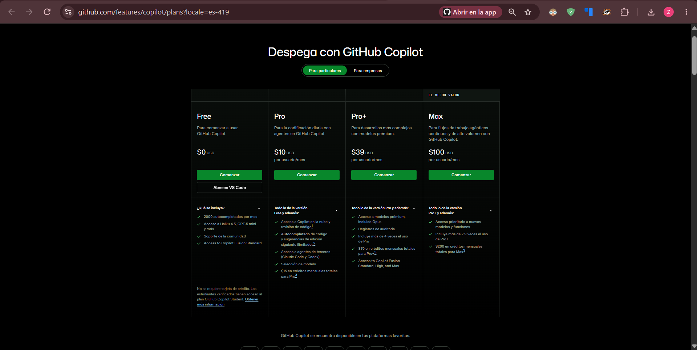
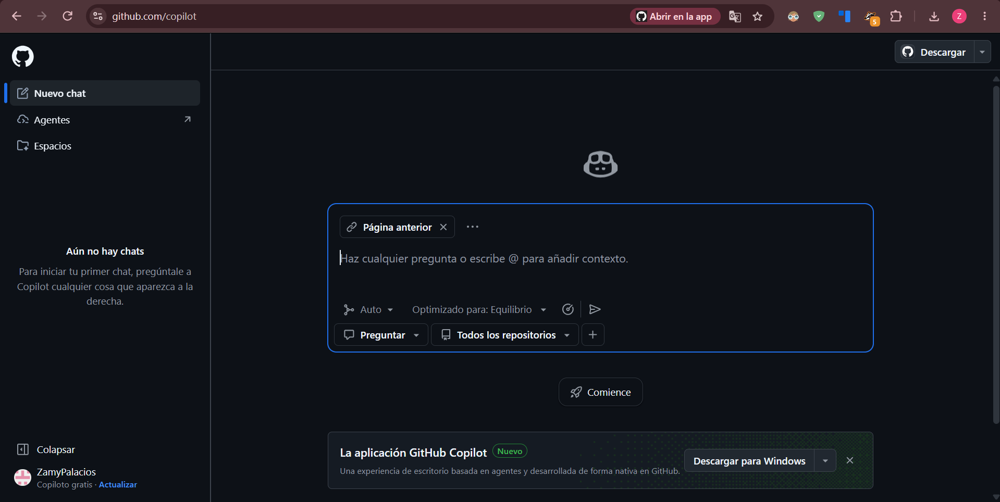
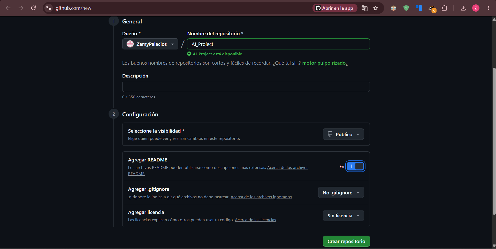
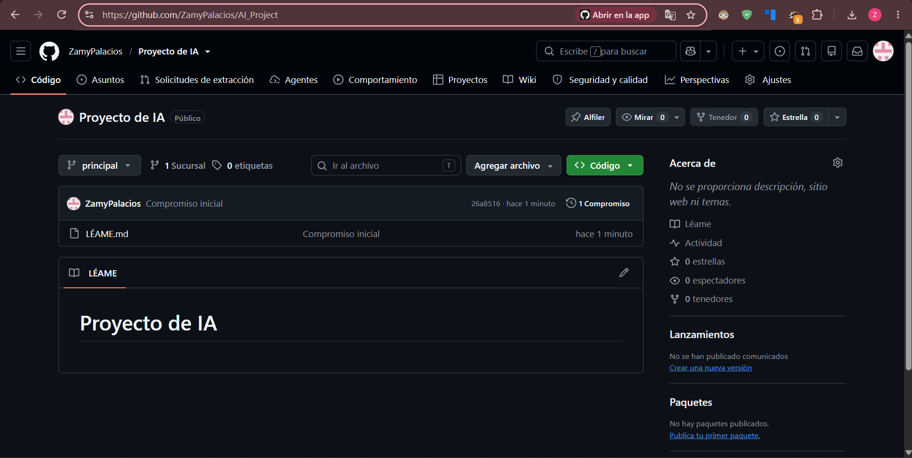
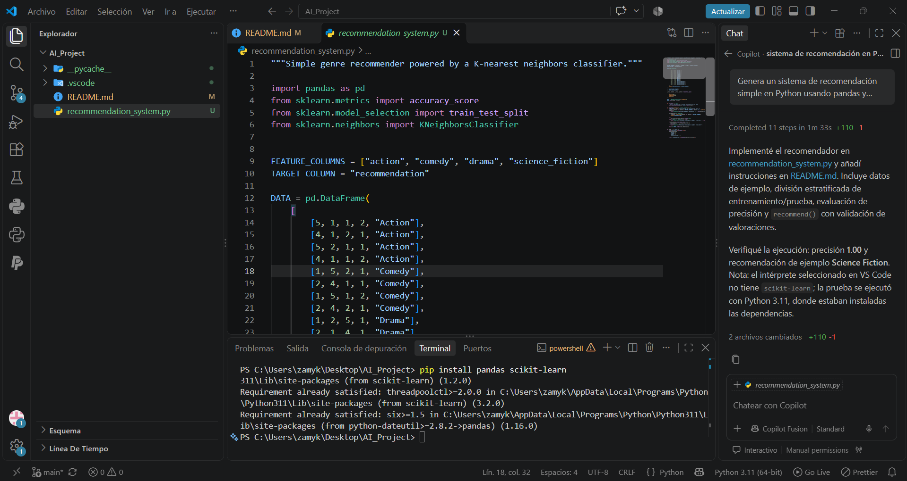
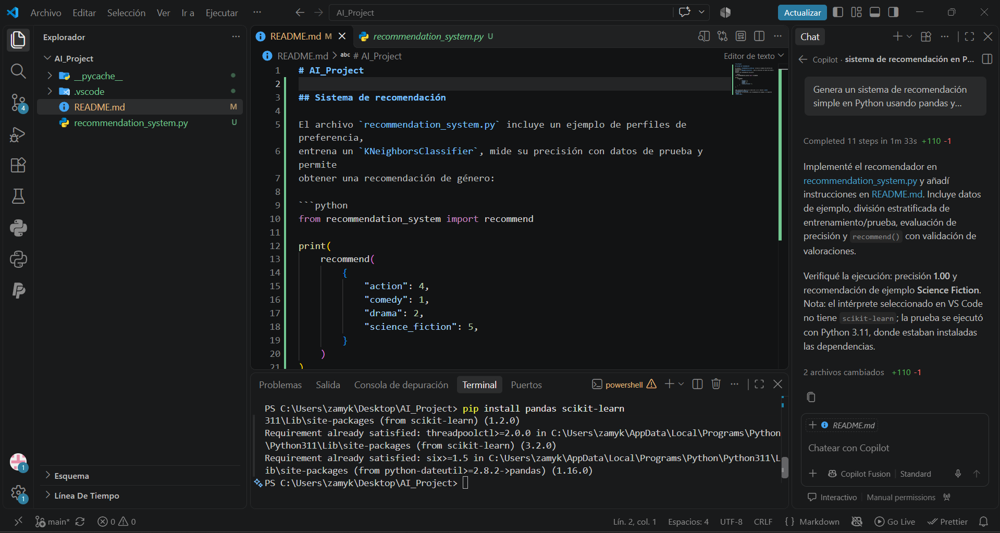

# AI_Project: Sistema de recomendación con GitHub Copilot

Actividad formativa de INACAP: exploración de tendencias emergentes en inteligencia artificial usando GitHub Copilot como herramienta práctica.

**Autor:** Zamy Palacios
**Repositorio:** https://github.com/ZamyPalacios/AI_Project

---

## Paso 1: Elegir el plan gratuito de GitHub Copilot

Ingresé a la página de planes de GitHub Copilot y seleccioné el plan **Free** (US$0), que no requiere tarjeta de crédito.



## Paso 2: Copilot activado en mi cuenta

Después de hacer clic en "Comenzar" en el plan Free, GitHub me llevó al chat de Copilot. En la esquina inferior izquierda se ve mi usuario con la leyenda "Copiloto gratis", lo que confirma que el plan quedó activo.



## Paso 3: Crear el repositorio

Desde GitHub creé un repositorio nuevo con estas opciones:

- **Nombre:** AI_Project
- **Visibilidad:** Público
- **README:** activado



## Paso 4: Repositorio creado

El repositorio quedó creado con su archivo README inicial.



## Paso 5: Clonar el repositorio en Visual Studio Code

En la terminal integrada de Visual Studio Code ejecuté:

```
git clone https://github.com/ZamyPalacios/AI_Project.git
cd AI_Project
```

## Paso 6: Generar el código con GitHub Copilot

Dentro de Visual Studio Code creé el archivo `recommendation_system.py` e inicié sesión en GitHub Copilot. En el chat de Copilot escribí este mensaje:

> Genera un sistema de recomendación simple en Python usando pandas y scikit-learn con KNeighborsClassifier. Incluye datos de ejemplo creados en el mismo código, división en entrenamiento y prueba, evaluación de precisión y una función recommend().

Copilot escribió el código directamente en el archivo y lo probó. Acepté los cambios con el botón "Mantener".



### Cómo funciona el código

1. **Datos de ejemplo:** una tabla con 16 perfiles. Cada uno tiene puntuaciones de 1 a 5 para acción, comedia, drama y ciencia ficción, y un género recomendado.
2. **División de datos:** se usa `train_test_split` para separar 75 % de los datos para entrenar y 25 % para probar.
3. **Modelo:** `KNeighborsClassifier` con 3 vecinos. Clasifica un perfil nuevo según los 3 perfiles más parecidos.
4. **Evaluación:** la función `evaluate()` calcula la precisión con los datos de prueba.
5. **Recomendación:** la función `recommend()` recibe las puntuaciones de una persona, valida que estén entre 1 y 5 y devuelve el género recomendado.

## Paso 7: Ejecución del programa

Ejecuté el programa desde la terminal con:

```
python recommendation_system.py
```

Resultado:

```
Accuracy: 1.00
Recommendation: Science Fiction
```

La captura muestra también el chat de Copilot con mi mensaje y su respuesta.



**Nota:** la precisión de 1.00 es tan alta porque el conjunto de datos es pequeño y está inventado con géneros muy fáciles de separar. Con datos reales, el resultado sería menor.

## Paso 8: Subir los cambios a GitHub

```
git add .
git commit -m "Add recommendation system example"
git push -u origin main
```

## Cómo ejecutar el proyecto

Requisitos: Python 3 con las librerías `pandas` y `scikit-learn`.

```
pip install pandas scikit-learn
python recommendation_system.py
```

También se puede usar la función `recommend()` desde otro archivo. Cada valoración debe ser un número del 1 al 5:

```python
from recommendation_system import recommend

print(recommend({"action": 4, "comedy": 1, "drama": 2, "science_fiction": 5}))
```

## Conclusión

Usé GitHub Copilot como herramienta de apoyo para generar un sistema de recomendación básico con aprendizaje automático. Copilot aceleró la escritura del código, pero es importante leerlo y entenderlo antes de usarlo.
